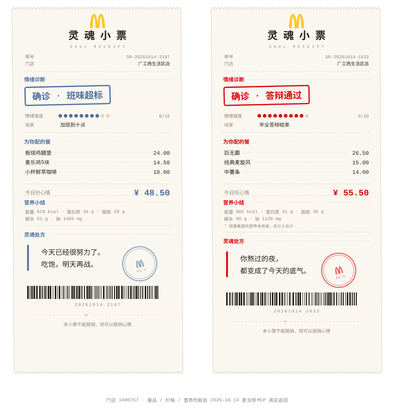
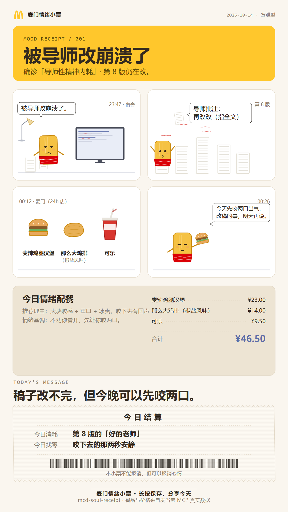
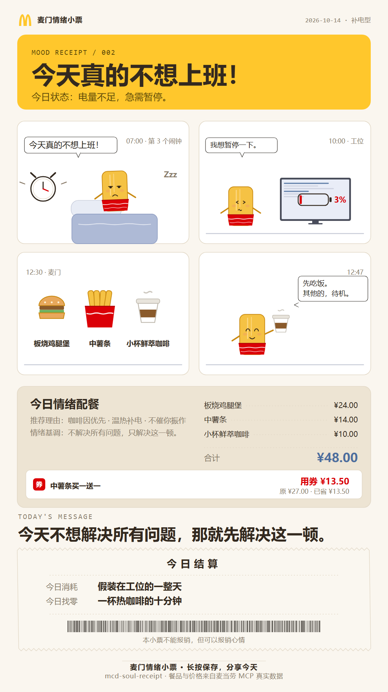
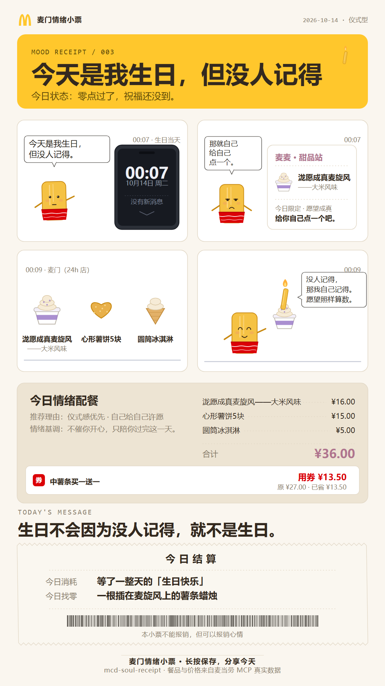
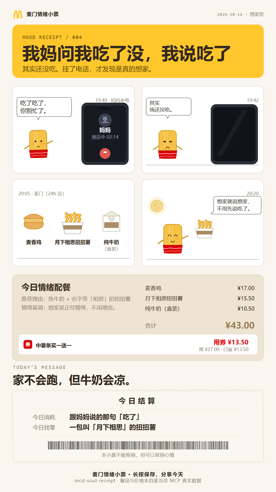
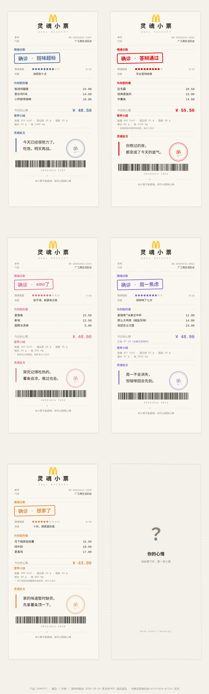

<div align="center">

# 麦门灵魂小票 · Soul Receipt

**说出你今天的心情，我们把它画成一张麦当劳四格漫画。**



*一份麦当劳套餐的价格，买不到的那句话，漫画替你说了。*

**纯提示词 Skill · 零依赖 · 基于麦当劳 MCP 真实菜单、真实价格、真实营养数据**

</div>

---

## 这是什么

普通人点麦当劳，拿到的是一张收银小票：商品名、单价、合计，仅此而已。

**麦门灵魂小票把顺序倒过来**——先听你说今天怎么了，再根据你的**具体经历**画一场四格小漫画，最后给你一张**可保存、可分享、可自嘲**的数字情绪卡。

```
你：被导师改崩溃了
        ↓
   情绪转译        破防·憋屈 · 确诊「导师性精神内耗」· 语义意图「发泄型」
        ↓
   真实菜单        query-meals 拉当前门店在售餐品
        ↓
   情绪配餐        发泄型 → 大块咬感 + 重口 + 冰爽饮品
        ↓
   核价营养        calculate-price + list-nutrition-foods
        ↓
   四格漫画        起承转合：起（你的原话）→ 承（夸张）→ 转（真实餐品登场）→ 合（不强行开心）
        ↓
   数字情绪卡      3:4 竖版 · 卡底「情绪结算」彩蛋
```

本质是三件事：**情绪表达**（接住你那句说不出口的话，原词保留）→ **情绪转译**（用真实菜单做情绪语义的匹配）→ **视觉纪念**（一张根据你的具体经历创作的四格漫画情绪卡）。

**三个核心特点**：餐品由官方 MCP 真实查询，绝不虚构；漫画根据你的**具体经历**创作，不套固定文案；有起承转合、有幽默感，**结尾不强行让你开心**。

**它不是算命，也不是营销话术。** 情绪转译是显式的、可核对的 JSON；配餐有打分公式；价格和营养全部来自麦当劳 MCP 的实时返回，**一个数字都不是编的**。漫画图像由**角色模板 + SVG 程序排版**生成——四格角色永远一致，不依赖 AI 画图。

> 重点不是算法有多强，而是够不够懂年轻人的情绪表达方式、够不够会说话、够不够值得分享。

---

## 为什么做这个

因为在麦当劳 MCP 的 650 个参赛项目里，大家在解决「怎么省钱」「怎么吃健康」「怎么点单」——这些都是**理性的问题**。

但没有人解决「我今天很累，想吃点好的」这种**不理性的时刻**。

而这恰恰是麦当劳真正被需要的场景。深夜十点的麦当劳不属于营养学，也不属于优惠券，它属于那个刚下班的人。

而且年轻人有自己的说法——他们说「班味重」，不说「工作疲惫」；说「被导师改崩溃了」，不说「学业压力大」；说「已老实」，不说「接受现实」。

**能不能接住这些说法，决定了这个 Skill 是懂他们，还是在自嗨。** 所以它的第一优先级资产是**情绪语料库**，而不是配色和排版。

---

## 快速开始

### 1. 申请麦当劳 MCP Token

访问 [open.mcd.cn/mcp](https://open.mcd.cn/mcp) → 手机号登录 → 控制台 → 激活 → 复制 Token。

### 2. 接入 MCP

在 MCP Client（WorkBuddy / Cursor / Cherry Studio / Trae 均可）中配置，把 `YOUR_MCP_TOKEN` 替换为你的真实 Token：

```json
{
  "mcpServers": {
    "mcd-mcp": {
      "type": "streamablehttp",
      "url": "https://mcp.mcd.cn",
      "headers": {
        "Authorization": "Bearer YOUR_MCP_TOKEN"
      }
    }
  }
}
```

完整配置见 [`mcp-config.example.json`](./mcp-config.example.json)。

### 3. 加载本 Skill

把本仓库的 `SKILL.md` 放入你的 MCP Client 的技能目录（WorkBuddy 为 `~/.workbuddy/skills/mcd-soul-receipt/`）。

### 4. 说一句话

```
今天答辩终于过了，想吃顿好的犒劳自己
```

得到一段回应 + 一个 `soul-receipt-*.html` 文件，浏览器打开即可截图分享。

> ⚠️ 首次使用需告知你所在的城市或位置，Skill 会据此查询附近门店。**不会猜测你的位置。**

---

## 它是怎么工作的

完整流程定义在 [`SKILL.md`](./SKILL.md)，这里是最关键的四条设计原则：

### ① 情绪必须先变成可核对的 JSON

```
{
  "emotion": "疲惫",
  "polarity": "negative",
  "intensity": 8,
  "scene": "加班到十点",
  "taste_vector": { "fried": 0.8, "sweet": 0.3, "caffeine": 0.9, "spicy": 0.2, "light": 0.1 },
  "tone": "quiet_companion"
}
```

没有这层结构化，所谓的「情绪配餐」就只是 LLM 的即兴发挥。**有了它，每次结果都可复现、可解释、可调整。**

### ② 配餐有打分公式，不是拍脑袋

```
score = Σ_k  taste_vector[k] × tag_k(餐品)
        + 0.3 × novelty(餐品)          // 限定款、新品加分
        − 0.5 × price_penalty(餐品)     // 单价明显偏高时扣分
```

- `tag_k` 由餐品名称、分类、标签推断，**推断值与官方数据严格区分**
- 用户有忌口但菜单数据无法判断时，**保守换品，绝不冒险**
- `caffeine > 0.6` 时强制包含咖啡因饮品（疲惫场景的硬规则）

### ③ 价格与营养，一个都不许编

每个餐品名、每个价格、每项营养数据都必须来自真实 MCP 返回。MCP 不可用时，输出「空白小票」并明确说明数据缺失——**宁可少一张小票，不编一个数字。**

### ④ 小票上只写人话

- ✅ 「今天已经很努力了。吃饱，明天再战。」
- ❌ 「根据您的情绪分析结果，为您推荐以下套餐」

处方文案限 **两行、每行不超过 14 字**。这是约束，也是质感。

---

## 情绪 → 口味 映射（节选）

完整表见 [`references/emotion-taste-map.md`](./references/emotion-taste-map.md)。

| 情绪 | 主导口味 | 必含 | 语气基调 |
|---|---|---|---|
| 疲惫 / 班味超标 | 油炸 0.8 · 咖啡因 0.9 | 咖啡因饮品 | 安静陪伴 |
| 委屈 / emo | 甜 0.8 · 轻食 0.2 | 甜食 | 温柔安慰 |
| 焦虑 / 压力大 | 油炸 0.7 · 咖啡因 0.5 | 高热量主食 | 幽默吐槽 |
| 兴奋 / 庆祝 | 甜 0.7 · 新鲜感 0.6 | 甜品 | 热血打气 |
| 空虚 / 无聊 | 新鲜感 0.8 | 限定款/新品 | 幽默吐槽 |
| 平静 / 没什么特别的 | 均衡 | — | 安静陪伴 |

---

## 示例输出

### 情绪漫画长卡（主交付物 · 1080×1920）

<table>
<tr>
<td></td>
<td></td>
</tr>
<tr>
<td></td>
<td></td>
</tr>
</table>

*四格漫画讲你的具体经历，情绪结算条是每张卡底部的固定彩蛋。*

### 情绪小票（早期版式 · 五情绪全家福）



*五种情绪 · 五种主题色：班味超标（加班蓝）/ 答辩通过（麦门红）/ emo了（安慰粉）/ 周一焦虑（焦躁紫）/ 想家了（炉火橙）*

完整输入输出样例见 [`examples/sample-output.md`](./examples/sample-output.md)。

> ✅ 样例为**真实执行记录**（2026-10-14，门店 1400757 · 广工西生活区餐厅）：五组情绪配餐（¥40.00–¥55.50）价格与营养全部来自 MCP 返回。其中「经典麦旋风」「新地」「月下相思扭扭薯」在营养列表中无对应条目，小票以脚注标明缺失而非取近似值——这正是本 Skill 的底线。周一焦虑组的「已省 ¥7.10」同样来自 `calculate-price` 的真实促销返回。真实菜单快照见 [`references/menu-snapshot-20261014.md`](./references/menu-snapshot-20261014.md)。

---

## 适合谁用

| 你是谁 | 你会怎么用 |
|---|---|
| 下班后的打工人 | 说一句「今天好累」，换一张能发朋友圈的小票 |
| 赶 due 的学生 | 答辩完、交完作业，用小票给自己一个仪式感 |
| 想送点小心意的人 | 把对方的心情打成小票截图发过去，比「多喝热水」有用 |
| 麦门信徒 | 收集不同心情的小票，攒一套「灵魂账本」 |

---

## 项目结构

```
mcd-soul-receipt/
├── README.md                      本文件
├── SKILL.md                       Skill 主体定义（核心）
├── MCP_INTEGRATION.md             MCP 工具清单、调用流程与业务价值
├── CONTEST_DECLARATION.md         参赛声明（官方原文，逐字节未改动）
├── mcp-config.example.json        脱敏 MCP 配置示例（环境变量占位符）
├── workbuddy.md                   WorkBuddy 开发对话上下文
├── assets/                        视觉资产（SVG 是源文件，PNG 是导出）
│   ├── comic-card-01.svg / .png / @1x.png   漫画长卡 · 被导师改崩溃（发泄型）
│   ├── comic-card-02.svg / .png / @1x.png   漫画长卡 · 今天真的不想上班（补电型）
│   ├── comic-card-03.svg / .png / @1x.png   漫画长卡 · 生日没人记得（仪式型）
│   ├── comic-card-04.svg / .png / @1x.png   漫画长卡 · 我妈问我吃了没（想家型）
│   ├── receipt-sample.svg / .png            两张对照小票（疲惫 / 庆祝）
│   └── receipts-gallery.svg / .png          五情绪小票全家福
├── references/
│   ├── emotion-lexicon.md         情绪语料库（核心资产）：人话 → 情绪簇 → 病名 → 语义意图
│   ├── emotion-taste-map.md       情绪 → 口味映射表（打分公式 + 一票否决）
│   ├── comic-spec.md              角色与漫画规范：麦仔设定、四格脚本、结算条
│   ├── receipt-spec.md            情绪结算条版式规范
│   ├── visual-design-rules.md     锁定设计系统：字号死线 / 色相上限 / 密度门禁
│   └── menu-snapshot-20261014.md  真实菜单与营养数据存档（实测凭证）
├── generator/                     视觉生成器（纯 Python 标准库，零依赖）
│   ├── README.md                  运行方法与三层结构说明
│   ├── gen_comic_card.py          基础构件库：麦仔 / 道具 / 餐品图标 / 气泡
│   ├── card_theme.py              版式套件（锁定 token，自动守设计规范）
│   └── gen_card_01~04.py          四张卡的四格故事与文案
├── tools/
│   └── density_check.py           密度门禁：交付前自检（纯标准库，零依赖）
└── examples/
    ├── sample-input.md            示例输入集
    ├── sample-output.md           完整输入输出样例（小票）
    └── comic-sample.md            四张漫画卡真实执行记录
```

**Skill 本体是纯提示词，视觉是可复现代码。** 使用时你不需要装任何东西——把 `SKILL.md`
交给 WorkBuddy 即可；`generator/` 是给想复现或二创的人准备的：每张样卡的每一根线条都能
用 `python generator/gen_card_NN.py` 重新画出来——**这也证明卡面不是 AI 画图生成的**。

---

## 设计取舍

**为什么 Skill 本体不写代码？**

因为在「情绪 → 一餐 + 一张漫画卡」这条链路上，LLM 的推理能力已经足够，而**确定性代码会带来部署成本**——用户需要装 Python、配环境。一个 Skill 应该是「复制即用」的。

**那 generator/ 是什么？**

是漫画卡的「印刷厂」。SKILL.md 描述卡面「应该长什么样」，generator 把它**像素级复现**：角色「麦仔」的身体比例在代码里恒定，表情只换眼睛和嘴巴——这是四格之间角色永远一致的唯一可靠办法，AI 画图做不到。你使用 Skill 时不需要它；你想改角色、换配色、做自己的卡时，它会帮上忙。

**代价是什么？**

是可复现性。纯提示词下，同一句话两次执行可能选到不同的小食。为此本 Skill 把**情绪转译、打分公式、语气匹配**全部写成显式规则，把自由度压到最低。剩余的不确定性集中在「同一分数档内的选品偏好」，这属于可接受范围。

---

## 边界与免责

- 本项目与麦当劳中国无官方关联，仅为基于公开 MCP 能力的创意开发
- 本 README 中的价格为 2026-10-14 实测值，实际以 MCP 实时返回为准
- 不收集、不存储任何用户情绪输入
- 涉及自伤或极端情绪表达时，Skill 会停止生成小票，并建议寻求专业帮助——**一张小票不解决情绪问题，人才能**

---

## License

[MIT](./LICENSE)

---

<div align="center">

*本小票不能报销，但可以报销心情。*

</div>
